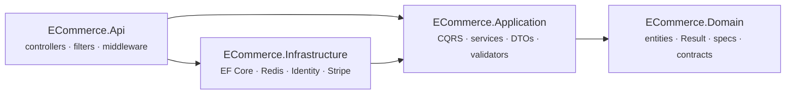
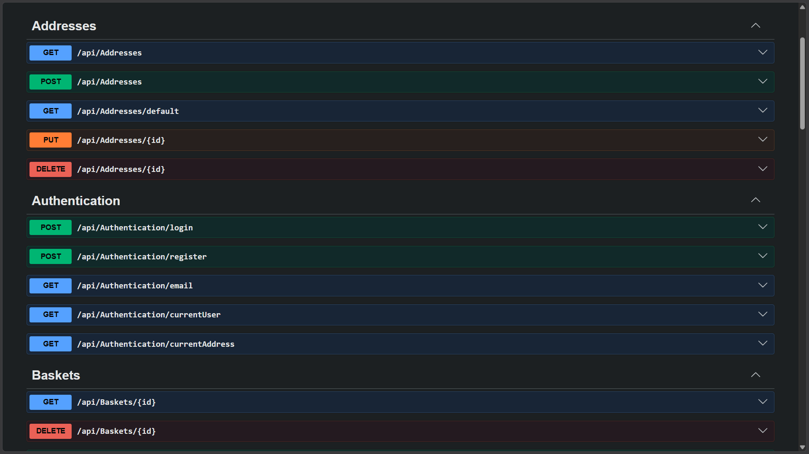
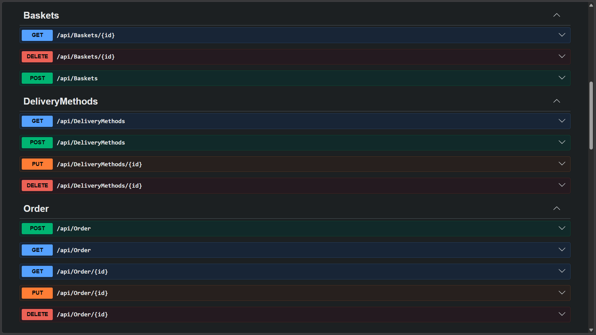
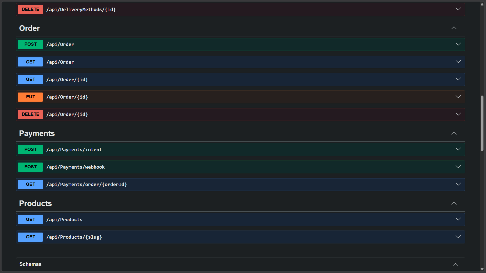
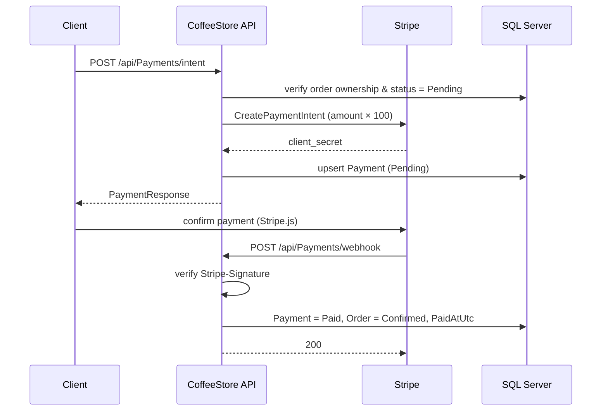

<div align="center">

# ☕ CoffeeStore

**A production-style coffee e-commerce API built with .NET 10, Clean Architecture, CQRS, Redis and Stripe.**

[](https://github.com/EngMohamedNowar/CoffeeStore/actions/workflows/build.yml)


[Key features](#-key-features) · [Architecture](#-architecture) · [Quick start](#-quick-start) · [API](#-api-reference) · [Tests](#-testing)

</div>

---

## 📖 Overview

CoffeeStore is a backend API for a coffee-shop e-commerce flow: catalogue browsing, Redis-backed baskets, order lifecycle management, address book, delivery methods and card payments through Stripe.

The codebase is organized around **Clean Architecture** with strict inward dependencies, a **Result pattern** instead of exceptions for business errors, **Specification** for composable queries, and **DDD-style aggregates** where invariants actually matter (orders, payments, delivery methods).

| | |
|---|---|
| **Solution** | `CoffeeStore/CoffeeStore.slnx` (5 projects) |
| **Runtime** | .NET 10, C# `latest`, nullable enabled, analyzers enforced at build |
| **Data** | SQL Server 2022 (EF Core 10, 8 migrations) + Redis 7 (cache & baskets) |
| **Auth** | ASP.NET Core Identity + JWT bearer (HMAC-SHA256) with roles |
| **Payments** | Stripe PaymentIntents with signed webhooks |
| **Tests** | 182 xUnit tests, NSubstitute, InMemory provider, coverage in CI |

## ✨ Key features

- **Catalogue** — products with variants (weight / grind / price / stock / SKU), roast levels, hierarchical categories, slug lookups, search, sorting and pagination.
- **Baskets** — Redis-persisted carts with a 7-day TTL, decoupled from the SQL catalogue.
- **Orders** — aggregate root with a static `Create` factory, immutable price/address snapshots, human-readable order numbers (`ORD-20261020120000-A1B2C3`) and an explicit status state machine.
- **Payments (Stripe)** — create *or reuse* a `PaymentIntent`, ownership checks, double-pay prevention, webhook signature verification, and `payment.succeeded` → order confirmed + `PaidAtUtc`.
- **Identity & addresses** — register/login, JWT issuance, roles (`Admin`, `SuperAdmin`, `User`), per-user address book with single-default semantics.
- **Caching** — `RedisCache` action filter for GET responses, user-scoped keys by default (opt-out for shared reads), errors are never cached.
- **Cross-cutting** — global FluentValidation filter, request timing middleware, `ProblemDetails` with `TraceId`, audit interceptor for `CreatedAt`/`UpdatedAt`, soft delete via global query filters, automatic migrations + JSON seeding on startup.

## 🏗 Architecture

Dependency flow is **strictly inward** — outer layers are replaceable, the domain depends on nothing:



```
CoffeeStore/
├── CoffeeStore.slnx              single solution file
├── docker-compose.yml            api + sqlserver + redis
├── docs/ERD.html                 interactive entity-relationship diagram
├── ECommerce/                    API host — controllers, DI, filters, middleware
├── ECommerce.Domain/             entities, repository contracts, Result/Error, specifications
├── ECommerce.Application/        CQRS handlers, services, DTOs, AutoMapper, FluentValidation
├── ECommerce.Infrastructure/     DbContexts, repositories, Redis, Identity, Stripe, migrations
├── Presentation/                 deck generator (OpenXML) + exported .pptx
└── tests/ECommerce.Tests/        xUnit suite (Api / Application / Domain / Infrastructure)
```

### Patterns in use

| Pattern | Where / why |
|---|---|
| **Result** | `Result`, `Result<T>`, `Error`, `ErrorType` — business failures never throw; `ApiControllerBase.ToProblem` maps every `ErrorType` to an HTTP status (404/400/401/403/409/500). |
| **Specification** | `ISpecification<T>` + `SpecificationEvaluator` compose predicates, ordering, includes and paging. Counts use `CreateCountQuery` so paging can never truncate the reported total. |
| **Repository + Unit of Work** | Transactional writes through `IUnitOfWork`; reads through spec-aware repositories. |
| **DDD aggregates** | `Order`/`Payment`/`DeliveryMethod` expose behaviour (`Create`, `Cancel`, `MarkAsPaid`, `ChangeStatus`) with private setters and encapsulated validation. |
| **State machine** | `Order.AllowedTransitions` — no skipping states, no resurrecting cancelled orders. |
| **CQRS-lite** | `IRequestDispatcher` / `IQueryDispatcher` route commands and queries to vertical-slice handlers. |
| **Keyed DI** | `AddKeyedScoped<IDataSeeder, …>("Catalog" \| "Delivery" \| "Identity")` — each seeder migrates only its own context. |
| **Soft delete + audit** | `IsDeleted` global query filters; `AuditInterceptor` stamps `CreatedAt`/`UpdatedAt` on `SaveChanges`. |

### Two databases, two contexts

| Context | Database | Holds |
|---|---|---|
| `StoreDbContext` | `CoffeeStoreDb` | products, categories, variants, orders, payments, delivery methods |
| `StoreIdentityDbContext` | `CoffeeStoreDb.Identity` | users, roles, addresses |

Migrations live in separate folders and are applied per-context, so neither context ever applies the other's migrations.

## 🚀 Quick start

### Prerequisites

- [.NET SDK 10.0.x](https://dotnet.microsoft.com/download)
- Docker (SQL Server + Redis)

### Option A — full stack with Docker

```bash
cd CoffeeStore
cp .env.example .env          # set MSSQL_SA_PASSWORD and JWT_SIGNING_KEY
docker compose up -d          # api → http://localhost:8080
```

Migrations and seed data are applied automatically on startup.

### Option B — run the API locally

```bash
cd CoffeeStore
cp .env.example .env
docker compose up -d sqlserver redis          # dependencies only

cd ECommerce
dotnet user-secrets set "ConnectionStrings:DefaultConnection"  "Server=127.0.0.1,1433;Database=CoffeeStoreDb;User Id=sa;Password=<password>;TrustServerCertificate=True"
dotnet user-secrets set "ConnectionStrings:IdentityConnection" "Server=127.0.0.1,1433;Database=CoffeeStoreDb.Identity;User Id=sa;Password=<password>;TrustServerCertificate=True"
dotnet user-secrets set "Jwt:SigningKey" "<at least 32 characters>"

dotnet run
```

| Environment | URL |
|---|---|
| HTTPS | `https://localhost:7135` |
| HTTP | `http://localhost:5260` |
| Swagger UI (Development) | <https://localhost:7135/swagger> |
| Docker | `http://localhost:8080` |

To seed an admin account, additionally set `Seed:Admin:UserName`, `Seed:Admin:Email` and `Seed:Admin:Password`. Seeding is skipped with a warning when the section is incomplete.

> **Secrets are never committed.** `appsettings.json` ships with empty placeholders — use `dotnet user-secrets` locally and environment variables (`Stripe__SecretKey`, `Jwt__SigningKey`, `ConnectionStrings__DefaultConnection`, …) in deployed environments.

## 🔌 API reference

> **Auth**: 🔓 anonymous · 🔒 any authenticated user · 🛡 `Admin` role

<details>
<summary><b>Authentication</b></summary>

| Method | Route | Auth | Description |
|---|---|---|---|
| POST | `/api/Authentication/login` | 🔓 | Issue a JWT |
| POST | `/api/Authentication/register` | 🔓 | Register and assign the `User` role |
| GET | `/api/Authentication/email?email=` | 🔓 | Check email existence |
| GET | `/api/Authentication/currentUser` | 🔒 | Current user profile |
| GET | `/api/Authentication/currentAddress` | 🔒 | Current user's default address |

</details>

<details>
<summary><b>Products &amp; Baskets</b></summary>

| Method | Route | Auth | Description |
|---|---|---|---|
| GET | `/api/Products` | 🔒 | Paginated list — `SearchName`, `Sort`, `PageIndex`, `PageSize` · *cached 300 s, shared* |
| GET | `/api/Products/{slug}` | 🔒 | Product by slug · *cached 300 s, shared* |
| GET | `/api/Baskets/{id}` | 🔓 | Read a basket |
| POST | `/api/Baskets` | 🔓 | Create / replace a basket |
| DELETE | `/api/Baskets/{id}` | 🔓 | Clear a basket |

</details>

<details>
<summary><b>Orders &amp; Payments</b></summary>

| Method | Route | Auth | Description |
|---|---|---|---|
| POST | `/api/Order` | 🔒 | Create an order from a basket |
| GET | `/api/Order` | 🔒 | My orders |
| GET | `/api/Order/{id}` | 🔒 | Order by id (ownership checked; admin bypass) |
| PUT | `/api/Order/{id}` | 🛡 | Update status via the state machine |
| DELETE | `/api/Order/{id}` | 🔒 | Cancel order (owner only, while `Pending`) |
| POST | `/api/Payments/intent` | 🔒 | Create or reuse a Stripe `PaymentIntent` |
| POST | `/api/Payments/webhook` | 🔓 | Stripe webhook — signature verified |
| GET | `/api/Payments/order/{orderId}` | 🔒 | Payment for an order |

</details>

<details>
<summary><b>Addresses &amp; Delivery methods</b></summary>

| Method | Route | Auth | Description |
|---|---|---|---|
| GET | `/api/Addresses` | 🔒 | My addresses |
| GET | `/api/Addresses/default` | 🔒 | My default address |
| POST | `/api/Addresses` | 🔒 | Add address (first one becomes default) |
| PUT | `/api/Addresses/{id}` | 🔒 | Update address |
| DELETE | `/api/Addresses/{id}` | 🔒 | Remove address |
| GET | `/api/DeliveryMethods` | 🔓 | Available delivery methods |
| POST | `/api/DeliveryMethods` | 🔒 | Create |
| PUT | `/api/DeliveryMethods/{id}` | 🔒 | Update |
| DELETE | `/api/DeliveryMethods/{id}` | 🔒 | Delete |

</details>

### Swagger UI

<p align="center">
  
</p>
<p align="center">
  
</p>
<p align="center">
  
</p>

### Payment flow



## ⚙️ Configuration

| Key | Purpose |
|---|---|
| `ConnectionStrings:DefaultConnection` | Catalogue database |
| `ConnectionStrings:IdentityConnection` | Identity database |
| `ConnectionStrings:RedisConnection` | Redis — response cache and baskets |
| `Jwt:Issuer` / `Jwt:Audience` | Token validation parameters |
| `Jwt:SigningKey` | HMAC-SHA256 key, **minimum 32 characters** (startup fails if empty) |
| `Jwt:ExpiryMinutes` | Token lifetime |
| `Stripe:SecretKey` | Server-side Stripe key (**never commit**) |
| `Stripe:PublishableKey` | Client-side Stripe key (safe to publish) |
| `Stripe:WebhookSecret` | Webhook signature secret |
| `Stripe:Currency` | Payment currency (default `usd`) |
| `Seed:Admin:*` | Optional admin account seeded at startup |
| `BaseUrl` | Prefix used to build absolute product-image URLs |

## 🧪 Testing

```bash
dotnet test CoffeeStore/CoffeeStore.slnx
```

**182 tests** across 28 files, organized by layer:

```
tests/ECommerce.Tests/
├── Api/              controller behaviour, Result→HTTP mapping, RedisCacheAttribute
├── Application/      command/query handlers, mapping, dispatchers, validators
├── Common/           Result / Error contracts
├── Domain/           Order state machine, DeliveryMethod, OrderItem
└── Infrastructure/   identity, seeders, persistence, SpecificationEvaluator
```

Representative examples: `ChangeStatus_SkippingStates_Fails`, `MarkAsPaid_FromCancelled_Fails`, `CacheHit_SkipsTheAction_AndReturnsTheCachedJson`, `Errors_AreNeverCached`, `ToProblem_MapsEveryErrorTypeToItsHttpStatus`, `CreateQuery_ReturnsTheFullMatchCountDespitePagingOnTheSpecification`.

Regression tests around counting and the not-found path were each verified to fail when their fix is reverted.

### CI

`.github/workflows/build.yml` runs on every push/PR to `main` and `develop`: restore → build (Release) → test with `XPlat Code Coverage` → upload `coverage.cobertura.xml` as an artifact.

## 🗄 Data model

An interactive ER diagram lives at [`CoffeeStore/docs/ERD.html`](CoffeeStore/docs/ERD.html) (open it in a browser).

Core entities: `Product` → `ProductVariant` → `Category` · `Customer` → `Order` → `OrderItem` · `Order` → `Payment` · `DeliveryMethod` · `UserAddress`.

Price history is snapshotted: each `OrderItem` stores a `ProductItemOrdered` copy (variant id, name, weight, unit price) and each `Order` stores the shipping-address and delivery-method price at creation time, so later catalogue edits never rewrite historical orders.

## 📚 More

| | |
|---|---|
| **Presentation deck** | [`CoffeeStore_Presentation.pptx`](CoffeeStore_Presentation.pptx) — regenerate with `CoffeeStore/Presentation/Generate-Presentation.ps1` |
| **ERD** | [`CoffeeStore/docs/ERD.html`](CoffeeStore/docs/ERD.html) |
| **Code style** | [`CoffeeStore/.editorconfig`](CoffeeStore/.editorconfig) — file-scoped namespaces, enforced in build via `EnforceCodeStyleInBuild` |

## 📌 Roadmap

- [ ] E-mail delivery (confirmation, order status notifications) — `IEmailSender` is not wired yet
- [ ] Admin authorization attributes on delivery-method mutations (currently authenticated-only)
- [ ] Refresh tokens / token revocation
- [ ] Paymob & Fawry payment methods (already modelled in `PaymentMethod`)

---

<div align="center">

Built with **.NET 10** · **Clean Architecture** · **Redis** · **Stripe**

</div>
